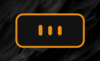

<p align="center">
  
</p>

<p align="center"><sub>Real plugin screenshot, cropped to the dictation indicator. Preview mode, current Omarchy theme.</sub></p>

# VoxWave — Voxtype OSD for Omarchy

[](https://github.com/0x1ocean/omarchy-voxtype-osd/releases)
[](https://github.com/0x1ocean/omarchy-voxtype-osd/actions/workflows/test.yml)
[](LICENSE)

See when [Voxtype](https://voxtype.io/) is listening and processing your speech.
VoxWave adds a compact dictation indicator to [Omarchy](https://omarchy.org/),
with three bars that respond to your voice and match your desktop theme.

Hold your dictation key to speak. Release it and the bars pulse while Voxtype
transcribes, then the indicator fades as your text is inserted. VoxWave stays
out of the way: it never takes focus or blocks clicks, and runs inside the
existing Omarchy Shell.

### Window glow

By default VoxWave lights up the frame of the window you are dictating into
instead of showing the pill. Light rises from both bottom corners, runs along
the bottom edge as a soft wave that follows your voice, and keeps the bottom
centre clear so the input line is never covered:

- **Listening, silent** — a thin, calm glow tucked into the corners.
- **Speaking** — the waves rise, speed up and reach inwards with your voice.
- **Transcribing** — the waves settle, the hue shifts, and a light runs back
  and forth along the bottom edge.
- **Done** — a short flash along the whole bottom edge; a cancelled recording
  simply fades out.

The glow uses your theme's accent colour and follows focus between windows and
monitors. To choose the indicator, set `indicator` in `lib/DictationConfig.js`
to `"glow"` (default), `"pill"` or `"both"`.

### Meeting support

During a Voxtype meeting, a static accent marker sits beside the status and
timer. No simulated microphone waveform is shown. `Recording`
requires fresh FFmpeg progress; `Paused` dims the marker, and `Finishing`
waits for the recorder to close before showing `Done`. Recorder failures show
`Audio error`, followed by `Check audio` at completion.
The timer stops during a pause, and the dictation waveform remains available
above it. English is the default language for meeting labels.

## Why VoxWave

- **Focused feedback** — dictation stays text-free; only meetings show a short
  status and timer.
- **Live microphone response** — adaptive noise gating keeps fans and room
  noise from looking like speech.
- **Restrained motion** — fast microphone response, gentle state transitions,
  and a brief completion cue without a scaling effect.
- **Native Omarchy theming** — popup surface, border, accent,
  spacing, scale, and corner radius update with the active theme.
- **Click-through overlay** — the OSD never captures keyboard or pointer input.
- **Local and private** — the visualizer consumes level metadata only; it does
  not save recordings or send data over the network.

## Requirements

- Omarchy with Shell plugin support
- Voxtype 1.0 or newer
- `voxtype-audio-bridge` from the Voxtype package
- `sqlite3` for an exact meeting start time; without it, the timer starts when
  VoxWave first sees the meeting

## Install

```bash
omarchy plugin add https://github.com/0x1ocean/omarchy-voxtype-osd.git --enable --yes
```

Disable Voxtype's built-in OSD and desktop notifications so VoxWave is the only
visual feedback:

```bash
voxtype config set osd.enabled false
voxtype config set output.notification.on_recording_start false
voxtype config set output.notification.on_recording_stop false
voxtype config set output.notification.on_transcription false
systemctl --user restart voxtype.service
```

Start dictating normally. VoxWave follows Voxtype's `recording`,
`transcribing`, and `idle` states automatically.

For meetings, enable `[meeting] enabled = true` in Voxtype's config and use
`voxtype meeting start`, `pause`, `resume`, and `stop`. VoxWave reads the
daemon's `meeting_state` file and the meeting start time from Voxtype's local
database. It stores a small clock checkpoint in the runtime directory so the
timer survives an Omarchy Shell restart, including while paused. VoxWave is
visual only: meeting audio is handled by the companion service below.

### Meeting audio

Install the companion from this checkout (requires `ffmpeg`, `pactl`,
`inotifywait` from `inotify-tools`, and `flock`):

```bash
install -Dm755 scripts/voxtype-meeting-audio ~/.local/bin/voxtype-meeting-audio
install -Dm644 scripts/voxtype-meeting-audio.service ~/.config/systemd/user/voxtype-meeting-audio.service
systemctl --user daemon-reload
systemctl --user enable --now voxtype-meeting-audio.service
```

Voxtype keeps its transcript JSON and index in
`$XDG_DATA_HOME/voxtype/meetings` (default `~/.local/share/voxtype/meetings`).
The companion writes `.mka` files in the sibling `meeting-audio` directory,
with the meeting ID in each filename. Each file contains three FLAC tracks:
Call (mix), Microphone, and System. Resuming after a pause creates a new part.
These audio files have no automatic retention policy; deleting a Voxtype
meeting does not clean up the companion's files.

### Automatic meeting notes

The exporter (Python 3.11+) saves completed transcripts to `~/notes/meetings`
as Markdown with speaker labels, timestamps, and meeting metadata. Filenames
contain the local start date/time and a short meeting ID. It checks every ten
seconds, catches up after login, and retries unfinished or failed exports.
Existing completed meetings are included on the first run. Export receipts
under `~/.local/state/voxtype` prevent overwriting edited notes or recreating
notes you move/delete.

```bash
install -Dm755 scripts/voxtype-meeting-export ~/.local/bin/voxtype-meeting-export
install -Dm644 scripts/voxtype-meeting-export.service ~/.config/systemd/user/voxtype-meeting-export.service
install -Dm644 scripts/voxtype-meeting-export.timer ~/.config/systemd/user/voxtype-meeting-export.timer
systemctl --user daemon-reload
systemctl --user enable --now voxtype-meeting-export.timer
```

To save pending notes immediately: `voxtype-meeting-export`. These notes are
full transcripts; AI summaries require a separately configured summarizer.

The recorder publishes a heartbeat and encoding progress to
`$XDG_RUNTIME_DIR/voxtype/meeting-audio/status.json`. The panel checks its age
and meeting ID. It grants startup eight seconds; missing heartbeats or stalled
encoding become an error. A recorder crash is retried after two seconds, and
the failure remains recorded for the completion result. Health confirms an
advancing encoder; it cannot verify that the selected inputs contain the
intended voices. Without the companion, dictation works normally, but meetings
cannot confirm audio recording.

## Update

```bash
omarchy plugin update io.github.0x1ocean.voxtype-osd
```

## Disable or remove

```bash
omarchy plugin disable io.github.0x1ocean.voxtype-osd
omarchy plugin remove io.github.0x1ocean.voxtype-osd
```

If you installed the optional meeting companions, remove them separately:

```bash
systemctl --user disable --now voxtype-meeting-audio.service voxtype-meeting-export.timer
systemctl --user stop voxtype-meeting-export.service
rm -f ~/.config/systemd/user/voxtype-meeting-audio.service \
  ~/.config/systemd/user/voxtype-meeting-export.service \
  ~/.config/systemd/user/voxtype-meeting-export.timer
rm -f ~/.local/bin/voxtype-meeting-audio ~/.local/bin/voxtype-meeting-export
systemctl --user daemon-reload
```

Saved meeting audio and Markdown notes remain on disk.

To return to Voxtype's built-in overlay:

```bash
voxtype config set osd.enabled true
systemctl --user restart voxtype.service
```

## How it works

VoxWave runs as a persistent `panel` inside the existing Omarchy Shell process.
It follows `omarchy-voxtype-status` for state changes and reads peak/RMS level
metadata from `voxtype-audio-bridge`. The overlay is mapped only while active,
and its animation timer stops when hidden.

```text
DictationOsd.qml                  panel composition and preview IPC
components/VoxtypeBridge.qml     Voxtype status, meeting state, audio levels
components/DictationSession.qml  dictation lifecycle and signal smoothing
components/MeetingSession.qml    meeting clock and runtime checkpoint
components/MeetingRecorder.qml   recorder heartbeat and health
components/MeetingPresentation.qml meeting lifecycle and completion feedback
components/DictationPill.qml     dictation presentation
components/DictationPreview.qml  development preview and IPC
components/MeetingPill.qml       meeting presentation
components/MeetingIndicator.qml  static meeting status marker
components/RestartingStream.qml  reconnecting status/audio processes
components/VoxSurface.qml        shared themed surface
components/Waveform.qml          waveform rendering
lib/DictationConfig.js           dictation sizes and motion timing
lib/WaveformMath.js              pure waveform calculations
lib/MeetingClock.js              pure meeting clock calculations
lib/VoxtypeProtocol.js           complete meeting-state parsing
lib/MeetingStatus.js             recorder health and presentation states
scripts/voxtype-meeting-audio    companion audio recorder
scripts/voxtype-meeting-export   automatic Markdown meeting notes
```

No colors are hard-coded in the renderer. The plugin binds directly to
Omarchy's `Color`, `Style`, and `Border` design tokens, including light themes
and user spacing/font scaling.

## Development

Clone and link the working tree into Omarchy:

```bash
git clone https://github.com/0x1ocean/omarchy-voxtype-osd.git
cd omarchy-voxtype-osd
ln -s "$PWD" ~/.config/omarchy/plugins/io.github.0x1ocean.voxtype-osd
omarchy plugin enable io.github.0x1ocean.voxtype-osd
omarchy restart shell
```

Run the tests and Omarchy manifest validation:

```bash
npm run check
```

Preview states without recording. The recording preview feeds a sample signal
through the waveform so the scrolling motion is visible:

```bash
omarchy-shell voxtype-osd preview recording
omarchy-shell voxtype-osd preview transcribing
omarchy-shell voxtype-osd preview meeting
omarchy-shell voxtype-osd preview paused
omarchy-shell voxtype-osd preview meeting-starting
omarchy-shell voxtype-osd preview meeting-finishing
omarchy-shell voxtype-osd preview meeting-done
omarchy-shell voxtype-osd preview meeting-error
omarchy-shell voxtype-osd hide
```

Leave the recording preview running for a few seconds before switching to
`preview transcribing` to see the same three bars change motion.

See [CONTRIBUTING.md](CONTRIBUTING.md) for contribution guidelines and
[CHANGELOG.md](CHANGELOG.md) for release history.

## License

[MIT](LICENSE) © 2026 0x1ocean
