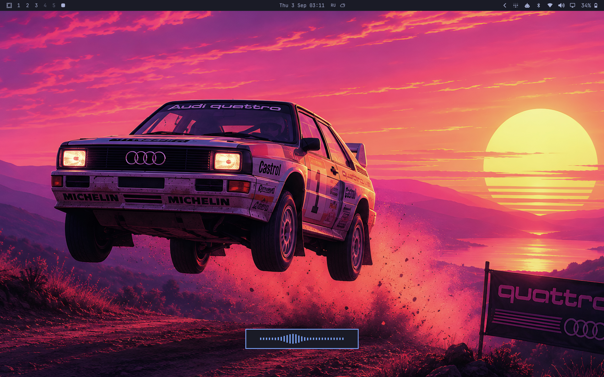

# VoxWave — Voxtype OSD for Omarchy

[](https://github.com/0x1ocean/omarchy-voxtype-osd/releases)
[](https://github.com/0x1ocean/omarchy-voxtype-osd/actions/workflows/test.yml)
[](LICENSE)

VoxWave is a minimal, theme-aware voice dictation OSD for
[Voxtype](https://voxtype.io/) on [Omarchy](https://omarchy.org/). It gives
clear visual feedback without notifications, labels, transcript previews, or
another standalone shell process.

Hold your dictation key and a live waveform grows from the centre. Release it
and the recording morphs into a travelling accent pulse while Voxtype
transcribes. The surface then settles and disappears as the text is inserted.

## Why VoxWave

- **Text-free feedback** — nothing competes with the words you are dictating.
- **Live microphone response** — adaptive noise gating keeps fans and room
  noise from looking like speech.
- **Snappy motion** — fast attack, soft release, seamless state transitions,
  and a compact completion animation.
- **Native Omarchy theming** — popup surface, border, recording color, accent,
  spacing, scale, and corner radius update with the active theme.
- **Click-through overlay** — the OSD never captures keyboard or pointer input.
- **Local and private** — the visualizer consumes level metadata only; it does
  not save recordings or send data over the network.

## Requirements

- Omarchy with Shell plugin support
- Voxtype 1.0 or newer
- `voxtype-audio-bridge` from the Voxtype package

## Install

```bash
omarchy plugin add https://github.com/0x1ocean/omarchy-voxtype-osd.git --enable --yes
```

Disable Voxtype's built-in OSD and desktop notifications so VoxWave is the only
visual feedback:

```bash
voxtype config set osd.enabled false
voxtype config set output.notification.on_recording_start false
voxtype config set output.notification.on_recording_stop false
voxtype config set output.notification.on_transcription false
systemctl --user restart voxtype.service
```

Start dictating normally. VoxWave follows Voxtype's `recording`,
`transcribing`, and `idle` states automatically.

## Update

```bash
omarchy plugin update io.github.0x1ocean.voxtype-osd
```

## Disable or remove

```bash
omarchy plugin disable io.github.0x1ocean.voxtype-osd
omarchy plugin remove io.github.0x1ocean.voxtype-osd
```

To return to Voxtype's built-in overlay:

```bash
voxtype config set osd.enabled true
systemctl --user restart voxtype.service
```

## How it works

VoxWave runs as a persistent `panel` inside the existing Omarchy Shell process.
It follows `omarchy-voxtype-status` for state changes and reads peak/RMS level
metadata from `voxtype-audio-bridge`. The overlay is mapped only while active,
and its animation timer stops when hidden.

```text
DictationOsd.qml              state machine, lifecycle, themed surface
components/VoxtypeBridge.qml Voxtype status and audio-level integration
components/Waveform.qml      waveform rendering and motion
lib/WaveformMath.js          pure, unit-tested signal and animation math
```

No colors are hard-coded in the renderer. The plugin binds directly to
Omarchy's `Color`, `Style`, and `Border` design tokens, including light themes
and user spacing/font scaling.

## Development

Clone and link the working tree into Omarchy:

```bash
git clone https://github.com/0x1ocean/omarchy-voxtype-osd.git
cd omarchy-voxtype-osd
ln -s "$PWD" ~/.config/omarchy/plugins/io.github.0x1ocean.voxtype-osd
omarchy-shell shell rescanPlugins
omarchy plugin enable io.github.0x1ocean.voxtype-osd
```

Run the dependency-free test suite and Omarchy manifest validation:

```bash
npm test
omarchy plugin validate "$PWD"
```

Preview states without recording:

```bash
omarchy-shell voxtype-osd preview recording
omarchy-shell voxtype-osd preview transcribing
omarchy-shell voxtype-osd hide
```

See [CONTRIBUTING.md](CONTRIBUTING.md) for contribution guidelines and
[CHANGELOG.md](CHANGELOG.md) for release history.

## License

[MIT](LICENSE) © 2026 0x1ocean
